# HOT MOTOR MOTION — éditeur motion design

<p align="center">
  
</p>

<p align="center">
  <b>Un éditeur de motion design qui tourne entièrement dans le navigateur.</b><br>
  Timeline, images clés, courbes d’accélération, capture WebM et lecteur
  autonome — sans build, sans compte, sans file de rendu.
</p>

<p align="center">
  <a href="#démarrage">Démarrage</a> ·
  <a href="#capacités">Capacités</a> ·
  <a href="#exports">Exports</a> ·
  <a href="#raccourcis">Raccourcis</a> ·
  <a href="#architecture">Architecture</a> ·
  <a href="#moteur-rust">Moteur Rust</a>
</p>

<p align="center">
  <a href="https://motion.zig-js.com/"><b>▶ Ouvrir l’éditeur — motion.zig-js.com</b></a>
</p>

<p align="center">
  <a href="https://github.com/zigmoon/HOTMOTORMOTION/actions/workflows/ci.yml"></a>
  <a href="https://motion.zig-js.com/"></a>
  <a href="LICENSE"></a>
</p>

> **La version web est en ligne : <https://motion.zig-js.com/>** — le moteur est la
> page elle-même. Un projet est un fichier JSON qui reste sur votre disque.

---

## Pourquoi HOT MOTOR MOTION

La plupart des outils d’animation dans le navigateur compensent une interpolation
pauvre par des images clés : cent positions pour un seul mouvement, parce que le
moteur ne sait tracer que des droites entre elles. Résultat : long à construire,
saccadé au défilement, impossible à reprendre six mois plus tard.

Cet éditeur fait l’inverse. Il embarque **de vraies courbes d’accélération** —
amorti, expo, rebond, élastique — appliquées **segment par segment**, au rendu,
dans l’éditeur comme dans chaque export. Un mouvement, c’est deux ou trois images
clés. On règle la courbe, pas les points.

Ce choix est vérifié, pas seulement documenté : la bibliothèque est contrôlée par
un script qui refuse tout preset au-delà de 20 formes ou 200 images clés
(`scripts/check-web.mjs`, exécuté en CI).

- **Aucun serveur, aucun compte.** Les fichiers ne quittent pas la machine.
- **Aucune étape de build.** `index.html` + `js/` + `css/` sont l’application.
- **Des exports qui gardent le rythme.** Lecteur HTML autonome, lecteur JS, projet
  JSON, capture WebM, et image SVG produite par le moteur Rust.

---

## Démarrage

```bash
npx serve .        # http://localhost:3000
```

Il n’y a pas de build. Servir `index.html` depuis n’importe quel serveur statique
suffit.

La version Astro (`astro/`), le moteur Rust (`rust/`) et la version web
enveloppent le **même** moteur — une seule source de vérité, pas trois. Voir
[Architecture](#architecture).

---

## Capacités

### Scène et formes

- **Canvas** 800 × 450, aperçu 60 i/s, zoom 25 % → 400 %, cadrage automatique au
  chargement.
- **Rectangle, cercle, texte, import SVG** — les SVG sont embarqués en data URL :
  un projet reste un seul fichier JSON autonome.
- **Transformations** : x, y, z (ordre de dessin), rotation, `rotationX` /
  `rotationY` (perspective approchée), échelle X/Y, cisaillement X/Y.
- **Apparence** : remplissage, opacité, flou, lueur avec sa propre couleur, teinte,
  saturation, luminosité, contraste.
- **Texte** : famille (20 Google Fonts + système), taille, graisse, couleur.

### Timeline

- Règle adaptative — graduations majeures et mineures, libellés en `m:SS` au-delà
  d’une minute.
- Colonne de calques alignée au pixel : index, nom, badge de type, sélection, survol.
- **Un repère par instant**, pas par propriété : losange pour un segment linéaire,
  cercle pour un segment courbe. Glisser déplace l’instant entier, double-clic le
  supprime.
- **Aimantation** à 7 px de toute image clé existante pendant le déplacement.
- Navigation image par image, boucle, durée de 3 s à 5 min.
- Zoom temporel 0,5× → 5× (`Ctrl` + molette, ou les boutons `−` / `Ajuster` / `+`).

### Courbes

Quatorze courbes vivent dans le moteur et sont recopiées à l’identique dans le
moteur Rust :

| Courbe | Sensation |
|---|---|
| `linear` | vitesse constante |
| `sineIn` / `sineOut` / `sineInOut` | doux, sans dépassement |
| `cubicIn` / `cubicOut` / `cubicInOut` | le quotidien |
| `expoIn` / `expoOut` / `expoInOut` | départ très vif ou arrêt très net |
| `backOut` / `backInOut` | petite anticipation / dépassement |
| `elasticOut` | retour oscillant |
| `spring` | amorti critique, dépassement court |

L’inspecteur expose les sept vraiment utiles, et applique la courbe choisie à
toutes les images clés de la forme sélectionnée en un clic.

### Inspecteur

Chaque champ numérique est éditable à la main, pas seulement au glissement :
position, taille, rotation, échelle, cisaillement, effets, nombre d’images clés.
Modifier une propriété déjà animée insère une image clé à la tête de lecture, avec
la courbe sélectionnée — jamais une écriture statique silencieuse.

### Bibliothèque

- **36 presets** en six familles : Fondations, Typographie, Révélations, Boucles,
  Démonstrations, Transitions. En appliquer un lance la lecture immédiatement.
- **16 scripts rapides** appliqués à la sélection courante (rotation, pulsation,
  rebond, glitch, glissements, oscillations…).
- Recherche sur les libellés et les identifiants ; l’état des groupes est restauré
  quand le champ est vidé.

### Annulation

50 étapes, instantanés complets de la scène. `Ctrl+Z` / `Ctrl+Shift+Z` / `Ctrl+Y`,
ignorés pendant la saisie dans un champ. Presets, scripts, déplacement d’images
clés et éditions par l’IA sont tous annulables.

---

## Exports

| Sortie | Contenu | Où |
|---|---|---|
| **HTML** | lecteur autonome : données, courbes, styles, contrôles | `Export JS` → *HTML complet* |
| **JavaScript** | le même lecteur, à coller dans une page existante | `Export JS` → *JS seul* |
| **JSON** | le projet lui-même, relisible par l’éditeur et par le moteur Rust | `Sauvegarder` / `Export JS` → *Data JSON* |
| **WebM** | capture temps réel, 640×360 → 3840×2160, 24/30/60 i/s | `Exporter WebM` |
| **SVG** | une image fixe, vectorielle, rendue par le moteur Rust | `motion-cli render` |

L’export WebM est plafonné à la 4K volontairement : au-delà, le canvas de capture
dépasse ce qu’un navigateur alloue, et l’échec se manifeste par un onglet figé au
lieu d’un message. Les très hautes résolutions relèvent du moteur Rust, pas de
`MediaRecorder`.

---

## Format de projet

Le fichier sauvegardé, c’est le projet entier. Rien d’autre n’est nécessaire pour
le rouvrir.

```json
{
  "app": "HOT MOTOR MOTION",
  "version": "1.0",
  "name": "HOT MOTOR MOTION Project",
  "created": "2026-10-25T00:00:00.000Z",
  "duration": 10,
  "canvas": { "width": 800, "height": 450 },
  "bgColor": "#121212",
  "shapes": [
    {
      "id": 1,
      "type": "Circle",
      "name": "Dot",
      "x": 120, "y": 225, "z": 0,
      "radius": 6,
      "fill": "#f5c518",
      "opacity": 0.9,
      "rotation": 0,
      "scaleX": 1, "scaleY": 1,
      "blur": 0, "glow": 0,
      "hue": 0, "saturation": 100, "brightness": 100, "contrast": 100,
      "keyframes": {
        "x": [
          { "t": 2.0, "v": 120, "e": "sineInOut" },
          { "t": 3.2, "v": 680, "e": "sineInOut" },
          { "t": 4.4, "v": 120 }
        ]
      }
    }
  ]
}
```

Une image clé est `{ "t": secondes, "v": valeur, "e": courbe }`. La courbe
appartient au segment qui **part** de cette image clé : c’est pourquoi la dernière
n’en porte généralement pas. Un champ absent reprend la valeur par défaut de
l’éditeur, un champ inconnu est ignoré — un projet écrit à la main doit s’ouvrir
sans outil.

---

## Raccourcis

| Raccourci | Action |
|---|---|
| `Espace` | lecture / pause |
| `←` / `→` | une image en arrière / avant (`Maj` = 10 images) |
| `Début` / `Fin` | début / fin de la timeline |
| `V`, `R`, `C`, `T` | sélection, rectangle, cercle, texte |
| `Suppr` / `Retour arrière` | supprime la sélection |
| `Ctrl+D` | duplique |
| `Ctrl+Z` / `Ctrl+Shift+Z` / `Ctrl+Y` | annuler / rétablir |
| `Ctrl` + `+` / `-` / `0` / `1` | zoom avant / arrière / reset / ajuster |
| `Ctrl` + molette | zoome le canvas, ou la timeline quand le pointeur y est |
| `Échap` | ferme la boîte ouverte, ou vide la recherche de la bibliothèque |

---

## Architecture

### Un moteur, trois couches

```
index.html + js/ + css/        le moteur et l'application (source de vérité)
astro/                          pages marketing + /editor, copie le moteur
rust/                           validation, SVG, HTML autonome, CLI
```

Le projet Astro ne duplique pas le code. `astro/scripts/sync-engine.mjs` copie
`js/`, `css/`, `img/`, `icons/` dans `public/assets/motion/`, extrait le corps de
`index.html` dans `src/generated/editor-shell.html` et — surtout — **recopie la
liste et l’ordre des balises `<script src>`** de `index.html`. Deux listes
maintenues à la main, c’est exactement la façon d’oublier un fichier et de voir une
fonction manquer à l’appel.

### Langage visuel

Sobre, dans la tradition SuperPhoto : accent encre sur des surfaces studio sombres,
un seul or (`#f5c518`) réservé à la marque. Tout est jeton dans `css/style.css` ;
changer de thème ne redessine jamais le canvas, qui garde ses propres couleurs.

| Groupe de jetons | Sombre (défaut) | Clair |
|---|---|---|
| `--bg-base` | `#121214` | `#f8f8f8` |
| `--bg-surface` | `#16161a` | `#ffffff` |
| `--text` | `#ececf1` | `#1a1a1a` |
| `--accent` | `#f0f0f2` (encre inversée) | `#1a1a1a` |
| `--gold` | `#f5c518` | `#b8860b` |

Le thème est appliqué par `js/theme.js` dans le `<head>`, avant le premier rendu :
aucun flash blanc au chargement. `prefers-reduced-motion` est respecté.

### Panneaux et état

Trois panneaux — inspecteur, scène, bibliothèque — plus la timeline. Les deux
panneaux latéraux se masquent depuis la barre supérieure ; le choix est mémorisé
(`hmm:panels`), comme le thème (`hmm:theme`). Au premier lancement et sur écran
étroit, la bibliothèque se replie au lieu de comprimer la scène à néant.

### API JavaScript

Tout ce que fait l’interface passe par ces objets, exposés pour le débogage et
pour l’assistant IA :

```js
window.editor.addShape('Rect');          // ajoute une forme
window.editor.serializeProject();        // le JSON écrit par « Sauvegarder »
window.editor.generateExportJS('full');  // 'full' | 'js' | 'data'
window.editor.undo();                    // instantanés, 50 étapes
window.editor.exportWebM(1920, 1080, 60, 10_000_000);
window.editor.timeline.seek(1.5);
window.HMMPresets.get('logoLockup');     // un preset par identifiant
window.HMMPresets.categories;            // la bibliothèque, pour construire une UI
```

### Assistant IA (facultatif)

Six fournisseurs (Gemini, Claude, GPT, Grok, Mistral, Cohere). Le modèle renvoie un
JSON strict — `action: add | modify | replace` plus formes et images clés — qui est
normalisé avant de toucher à la scène : courbes inconnues écartées, valeurs non
numériques rejetées, et chaque édition annulable.

La clé API est la vôtre ; elle n’est jamais stockée. En version autonome,
`proxy.php` relaie l’appel (CORS). En version Astro, `/api/ai` s’en charge avec une
liste blanche d’hôtes. Les deux refusent toute cible qui n’est pas l’un des six
points d’entrée HTTPS connus — un relais ouvert est une faille SSRF, pas un
service.

### Motion Control (facultatif)

Un panneau caméra déplace la forme sélectionnée au mouvement de la main. La
détection est une différence de blocs sur une image 320 × 240 (`MotionDetector`),
pas un modèle de neurones : aucun téléchargement, aucune chauffe, et en cas
d’échec cela ne fait rien plutôt que n’importe quoi.

### Hors ligne (PWA)

`sw.js` précache 14 fichiers — la page, les quatre scripts, la feuille de style,
le logo, les icônes et `offline.html` — pour que l’éditeur s’ouvre sans réseau
dès qu’il a été visité une fois. Deux stratégies, et deux seulement :

| Requête | Stratégie | Pourquoi |
|---|---|---|
| navigation | réseau d’abord, 700 ms au maximum si une copie existe | la page doit être fraîche ; un portail captif ne doit pas la bloquer |
| scripts, styles, images, polices | cache d’abord, rafraîchi en arrière-plan | démarrage instantané ; la mise à jour arrive à la visite suivante |

`/api/`, `proxy.php`, les requêtes non-GET, les requêtes `Range` et les autres
origines ne sont jamais interceptés. Mesuré serveur éteint : **920 ms** entre le
clic et un éditeur utilisable, logo et 36 presets compris.

Le précache est revérifié à chaque visite (message `REPAIR`) et reconstruit si un
cache a été vidé : un worker actif mais vide est réparé au lieu de laisser
l’application cassée. Supprimer une version consiste à incrémenter `VERSION` dans
`sw.js` ; les anciens caches sont supprimés à l’activation.

Pour le désactiver pendant le développement, ouvrir l’éditeur avec `?sw=off` :
le worker est désinscrit, les caches purgés, la page rechargée une fois.
L’enregistrement est ignoré en `file://` et sur un hôte HTTP quelconque :
ouvrir `index.html` depuis le disque se comporte donc exactement comme avant.

---

## Version Astro

```bash
cd astro
npm ci             # versions exactes de package-lock.json
npm run dev        # http://localhost:4321
npm run build      # adaptateur node, autonome
npm start
```

| Route | Contenu |
|---|---|
| `/` | page d’accueil |
| `/editor` | l’éditeur complet, moteur copié par `sync` |
| `/api/health` | état du service |
| `/api/ai` | relais IA (hôtes en liste blanche) |
| `/sitemap.xml` | sitemap |

Détails, variables d’environnement et contrat de synchronisation :
[`astro/README.md`](astro/README.md).

---

## Moteur Rust

Zéro dépendance — son propre lecteur JSON, son propre écrivain, les mêmes courbes.

```bash
cd rust
./scripts/build.ps1        # Windows : MSVC si présent, MinGW sinon
./scripts/build.sh         # Linux / macOS

motion-cli inspect examples/sample.motion.json
motion-cli validate examples/sample.motion.json     # code 1 en cas d'erreur
motion-cli render examples/sample.motion.json --at 1.2 -o frame.svg
motion-cli to-html examples/sample.motion.json -o animation.html
motion-cli serve .. --port 8787
```

`inspect` résume formes, images clés, instants distincts, la propriété la plus
dense et les courbes utilisées. `validate` attrape les identifiants en double, les
types de formes inconnus, les images clés hors durée, les courbes inconnues, les
opacités impossibles et les formes hors cadre. Le rendu SVG approche les filtres du
canvas (flou, lueur, teinte, saturation, luminosité, contraste) et le dit — voir le
tableau de fidélité dans [`rust/README.md`](rust/README.md).

47 tests, hors ligne :

```bash
cargo test --offline
```

---

## Notes de développement

### Contrôles avant de committer

```bash
npm run check      # node scripts/check-web.mjs
```

Aucune dépendance. Le script compile les quatre fichiers, vérifie que chaque
`getElementById` du moteur correspond à un identifiant de `index.html` (ou est créé
au runtime), contrôle les variables CSS et l’équilibre des accolades, vérifie que
chaque ressource locale référencée existe, et **exécute chaque preset dans un
harnais** pour faire respecter le budget de légèreté. Un preset qui grossit jusqu’à
200 formes fait échouer la CI.

### Copies générées

`astro/public/assets/motion/`, `astro/public/manifest.webmanifest` et
`astro/src/generated/` sont des produits de build, ignorés par Git. On modifie
`js/`, `css/`, `img/`, `icons/` ou `index.html`, puis `npm run sync`.

### Ce que lance la CI

| Job | Ce qu’il prouve |
|---|---|
| *Moteur web* | `node scripts/check-web.mjs` : les scripts compilent, chaque identifiant résout, les ressources existent, chaque preset reste dans le budget. |
| *Build Astro* | `npm ci` (le verrouillage correspond toujours à `package.json`), `npm run build`, puis le serveur compilé est démarré et `/`, `/editor`, `/api/health`, `/sitemap.xml` et `/assets/motion/js/bundle.js` sont interrogés en HTTP. |
| *Moteur Rust* | `cargo test` hors ligne, puis `inspect` et `render` sur le projet d’exemple. |

En local, le même build : `cd astro && npm ci && npm run build && npm start`.

### Hébergement dans un sous-dossier

Tous les chemins de `index.html` sont relatifs (`css/style.css`, `js/bundle.js`,
`img/…`) et le manifeste utilise `start_url: "./"`. L’application se dépose dans
`/motion/` sur n’importe quel serveur statique, sans réécriture. Le build Astro fait
exception : il suppose la racine du domaine et sert le moteur depuis
`/assets/motion/`.

### Navigateurs

Chromium, Firefox et Safari, versions courantes. La capture WebM exige
`MediaRecorder` et `canvas.captureStream` ; sans eux, l’éditeur le dit et renvoie
vers l’export JS/HTML au lieu d’échouer en silence. Le contrôle caméra exige
`getUserMedia` et un contexte sécurisé.

---

## Feuille de route

- **Version bureau** (Tauri) : le même moteur, hors ligne, avec des dialogues de
  fichiers natifs.
- **Courbes par propriété dans la timeline** : un éditeur de courbe par segment, et
  pas seulement le sélecteur global.
- **Rust : export vidéo** via un vrai encodeur, pour dépasser le plafond 4K de
  `MediaRecorder`.

---

## Licence

MIT — voir [LICENSE](LICENSE).

HOT MOTOR MOTION, son nom et son logo appartiennent à Simon Dupont (zigmoon).
